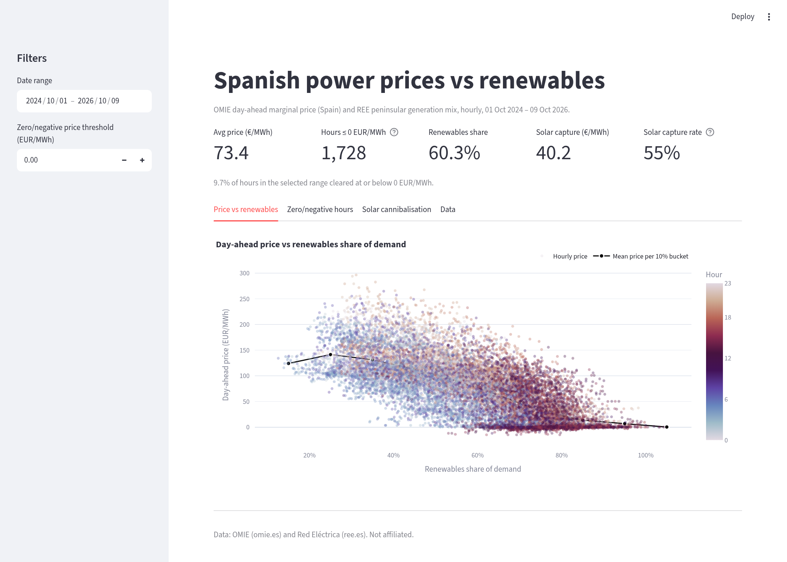
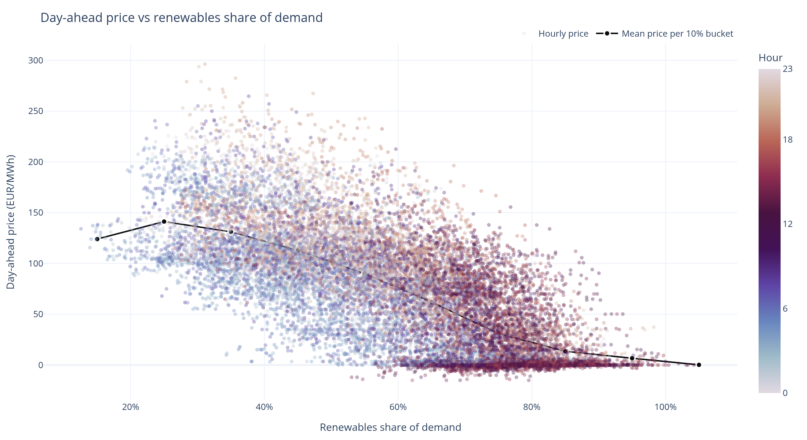
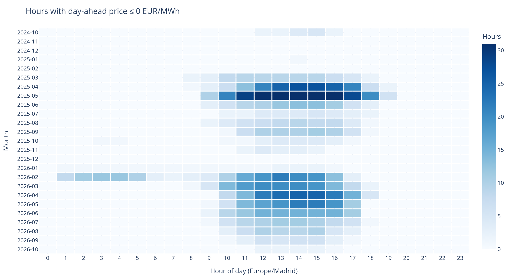
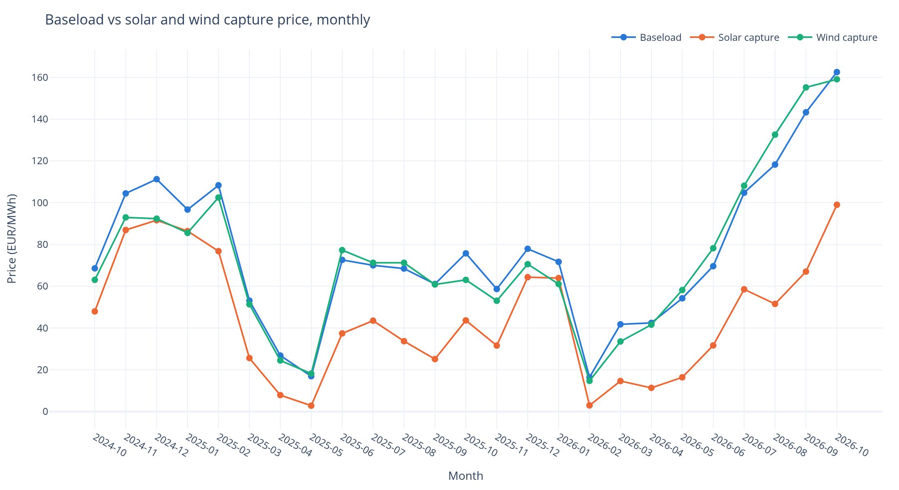
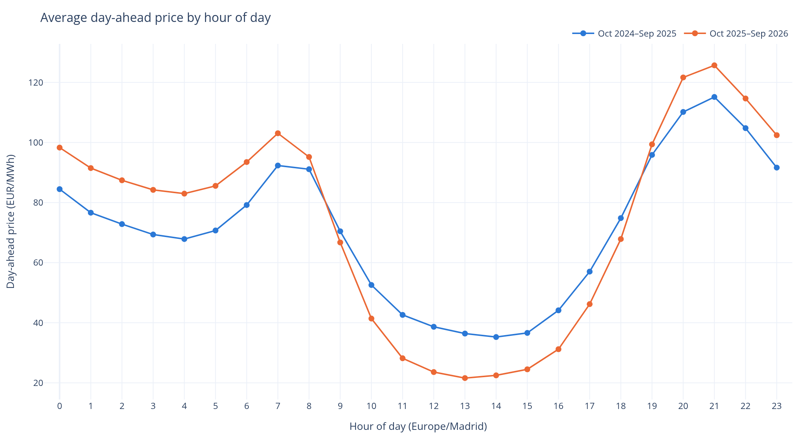

# Spanish power prices vs renewables

Interactive analysis of the Spanish day-ahead electricity market against the peninsular
generation mix, Oct 2024 to Oct 2026, built on public data with no API token.

It answers three questions:

1. How does the day-ahead price move as renewables cover more of demand?
2. When do zero and negative prices happen, by month and hour?
3. **Solar cannibalisation:** how far below the average price does solar's output clear, and is the gap widening?



## Key findings

Hourly data from 1 Oct 2024 to 9 Oct 2026 (17,735 hours). The two comparison windows are
Oct–Sep years, so both cover a full seasonal cycle. All numbers are computed in
[`notebooks/analysis.ipynb`](notebooks/analysis.ipynb) via `spain_power.findings`.

| | Oct 2024–Sep 2025 | Oct 2025–Sep 2026 |
|---|---:|---:|
| Average day-ahead price (EUR/MWh) | 71.3 | 73.3 |
| Hours at or below 0 EUR/MWh | 775 (8.8%) | 944 (10.8%) |
| …of which strictly negative | 540 | 768 |
| Renewables share of demand | 59.6% | 61.1% |
| Solar share of demand | 21.5% | 24.9% |
| Solar capture price (EUR/MWh) | 40.1 | 38.9 |
| Solar capture rate (vs baseload) | 56% | 53% |
| Avg price 11:00–16:59 vs 19:00–22:59 (EUR/MWh) | 38.9 vs 106.5 | 25.3 vs 115.3 |

1. **Prices fall as renewables cover more of demand.** Hourly price and renewables share correlate at
   **−0.72**. When renewables cover under 40% of demand, the average price is
   **133.6 EUR/MWh**. At 80% or more it falls to **12.9 EUR/MWh**, with a median of
   2.6.
2. **Zero-price hours are growing, and they cluster at midday in spring.** 1,728 hours
   (9.7%) cleared at or below zero, and **91%** of them fell between 10:00 and 17:59. The
   peak was May 2025, with 269 such hours. Negative prices stay shallow: the lowest hourly
   average was −15 EUR/MWh.
3. **Solar is cannibalising its own price.** Solar sold at **53%** of the baseload price
   in the latest year, down from 56%, while its share of demand rose from 21.5% to 24.9%.
   In the worst month (May 2025) solar captured only **17%** of baseload.
4. **The duck curve is deepening.** Average midday prices fell from 38.9 to 25.3 EUR/MWh,
   while evening prices rose from 106.5 to 115.3. That widening spread is the revenue
   opportunity for batteries and flexible demand.
5. **Wind behaves differently.** Wind's capture price tracks baseload closely because wind
   output is spread across the day. February 2026 shows the wind case: overnight prices
   averaged 5.7 EUR/MWh with wind covering 38% of night-time demand, against 98.8 EUR/MWh
   and 25% a year earlier.

<table>
<tr><td></td>
<td></td></tr>
<tr><td></td>
<td></td></tr>
</table>

## What's in the repo

```
app/streamlit_app.py        interactive dashboard (date filter, threshold, KPIs, 4 tabs, CSV export)
notebooks/analysis.ipynb    the analysis, executed, with static charts that render on GitHub
src/spain_power/
  omie.py                   OMIE day-ahead price files: parse, 15-min -> hourly, DST-safe
  ree.py                    REE real-time generation mix + REData daily totals
  esios.py                  optional ESIOS client (needs ESIOS_TOKEN; not used by default)
  cache.py                  per-day parquet cache in data/raw, combined table in data/processed
  transform.py              join, calibration, renewables share, capture prices, KPIs
  charts.py                 plotly figures shared by the app, notebook and README images
  findings.py               headline numbers used in this README
scripts/
  refresh.py                incremental daily refresh (+ rebuild of hourly.parquet)
  render_figures.py         README chart PNGs (kaleido)
  screenshot_app.py         dashboard screenshot (playwright)
  build_notebook.py         regenerates the notebook source
tests/                      41 offline pytest tests using recorded fixtures
data/processed/hourly.parquet   the hourly dataset (committed so the app runs on clone)
```

## Run it

```bash
python -m venv .venv && source .venv/bin/activate
pip install -e ".[dev]"

streamlit run app/streamlit_app.py      # dashboard on http://localhost:8501
python scripts/refresh.py               # pull new days (first run without data/raw: ~10 min)
pytest -q && ruff check .
jupyter nbconvert --to notebook --execute --inplace notebooks/analysis.ipynb
```

`refresh.py` defaults to the last 24 months. Use `--start` / `--end` for other ranges.

CI (`.github/workflows/ci.yml`) runs lint and tests on pushes to `main` and on pull requests.
`.github/workflows/refresh.yml` runs the refresh and tests daily at 14:30 UTC, after OMIE
publishes next-day prices, and uploads the new table as an artifact. To have it commit the
table back to the repo, set the repository variable `COMMIT_DATA=true`.

## Data sources and method

| Data | Source | Token | Resolution |
|---|---|---|---|
| Day-ahead marginal price, Spain | [OMIE](https://www.omie.es) `marginalpdbc` daily files | none | hourly; 15-min from 1 Oct 2025 |
| Demand and generation by technology, peninsular | REE real-time demand viewer feed ([demanda.ree.es](https://demanda.ree.es)) | none | 5-min |
| Official daily generation and demand, peninsular | [REE REData API](https://www.ree.es/en/datos/apidata) (`apidatos.ree.es`) | none | daily |
| (optional) ESIOS indicators | [ESIOS](https://www.esios.ree.es) | `ESIOS_TOKEN` | — |

Method notes:

- **Prices.** OMIE moved the day-ahead market to 15-minute periods on 1 Oct 2025. Those
  periods are averaged to clock hours, with timestamps built in UTC so the 23- and 25-hour
  DST days are handled correctly. When a day's `.1` file has been replaced by a corrected
  version, the loader falls back to `.2`, `.3` and so on.
- **Why not REData for hourly generation?** The REData generation-structure endpoint only
  serves daily data. The hourly shape therefore comes from REE's real-time feed (5-min
  readings averaged to hours; the repeated DST hour is labelled `2A`/`2B` and handled).
- **Calibration.** The real-time feed changed method on **11 Dec 2025**. Solar PV jumped by
  about 23% overnight relative to REData, and demand by about 3%. To keep the series
  consistent, each day's hourly wind, solar, hydro and demand values are scaled so their
  daily totals match REE's official REData figures. Only complete days (all 23/24/25 clock
  hours present, with a REData total for every series) are scaled, and scaling runs before
  prices are joined. The `*_rt` columns keep the raw values, and the `calibrated` column
  flags which days were scaled; in the current data that is every day except the partial
  current day.
- **Renewables share** = (wind + solar PV + solar thermal + hydro) / peninsular demand.
  Hydro is reported net of pumped-storage consumption, so it is clipped at zero. The share
  can exceed 100% when Spain is exporting or pumping.
- **Capture price** = Σ(price × generation) / Σ(generation). **Capture rate** = capture
  price / simple average (baseload) price. Both are computed on hourly values. Since the
  move to 15-minute prices they are an hourly proxy, because within-hour co-movement of
  price and output is averaged away.
- **Iberian blackout, 28 Apr 2025 from 12:33.** That day's prices are kept, because they
  were set the day before. Its afternoon hours are excluded from renewables-share
  calculations, including the aggregate shares in the table above, because measured
  demand collapsed to near zero.

**Limitations.** The analysis covers the day-ahead market only, with no intraday,
balancing or capacity revenues. REE's real-time values are provisional. The Balearic and
Canary systems are excluded.

### Licences and attribution

- **OMIE:** public, free information that may be used freely if its original content is
  respected, with the source cited ([legal notice](https://www.omie.es/en/legal-warning)).
  *Source: OMIE, Mercado diario, precio marginal (marginalpdbc).*
- **Red Eléctrica (REE):** reuse citing REE as the source is permitted for informative,
  non-commercial purposes; commercial use needs REE's prior written authorisation
  ([aviso legal](https://www.ree.es/es/aviso-legal)). *Source: Red Eléctrica, REData and
  demand monitoring.*
- This project is not affiliated with OMIE or Red Eléctrica. The code is MIT-licensed (see
  [LICENSE](LICENSE)). The licence does not cover the third-party data.

## Video explainer

A 20-second animated explainer of the solar findings (Remotion, 1080×1080) lives in [`video/`](video/README.md). Numbers are exported from the processed data by `scripts/export_video_data.py`.
