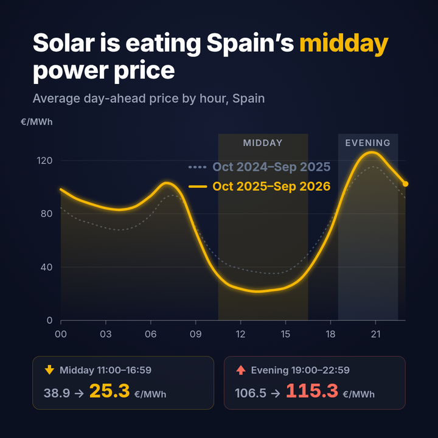

# Solar explainer video (Remotion)

A 26.5-second, 1080×1080, 30 fps animated explainer of the solar findings, built with
[Remotion](https://www.remotion.dev/) (React → video). The year-1 hourly price curve draws in,
morphs into year 2 (the midday "duck" deepens, the evening peak rises), then the headline
numbers land.



## Data

Every number on screen comes from `src/data.json`, which is generated from
`data/processed/hourly.parquet` through `spain_power.findings` — no hand-typed values:

```bash
# from the repo root
.venv/bin/python scripts/export_video_data.py
```

## Render

```bash
cd video
npm ci
npx remotion browser ensure      # headless Chromium, first run only
npm run render                    # -> out/solar-explainer.mp4 (not committed)
npm run stills                    # start / middle / callouts / transition / end PNGs in out/
npm run studio                    # live preview
```

`out/` is git-ignored; only `poster.png` is committed.

Composition code: `src/SolarExplainer.tsx` (scene layout), `src/Chart.tsx` (axes, bands,
draw-in and morph), `src/Callouts.tsx`, `src/EndCard.tsx`, timings in `src/timeline.ts`.
Written mainly by Claude Code, reviewed by Codex.
